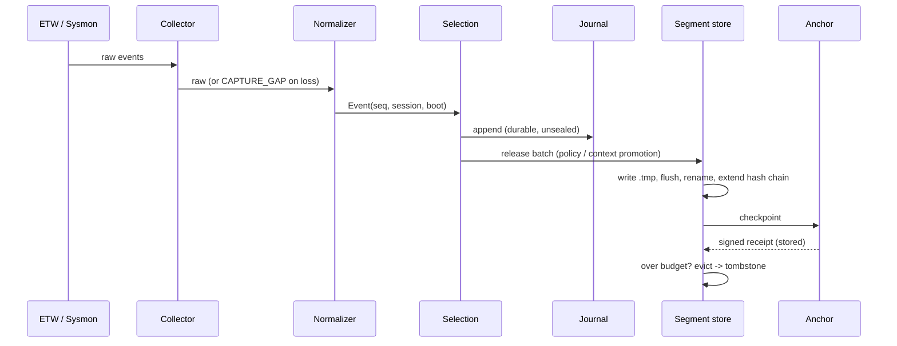
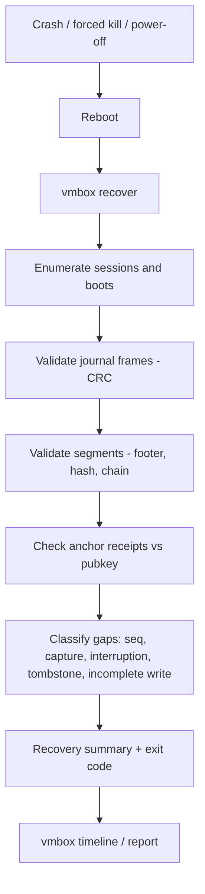
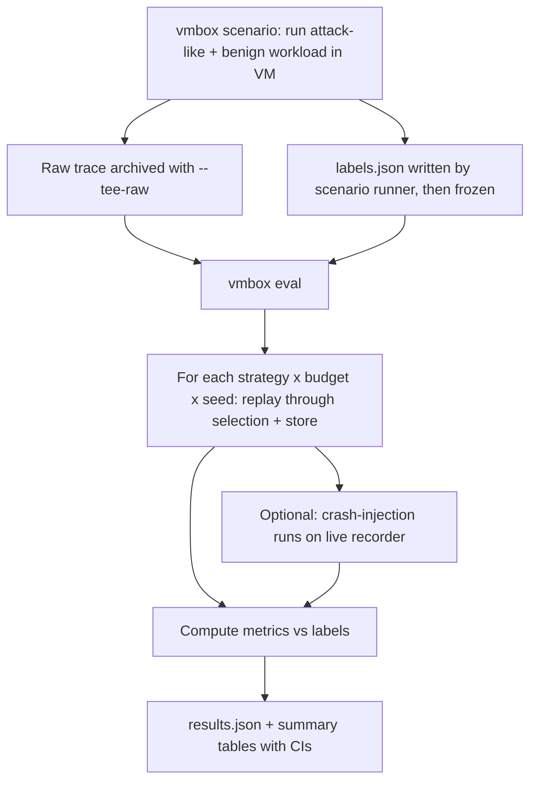

# APPFLOW — V-MBOX

V-MBOX is a CLI tool plus two long-running processes (recorder, anchor). There is no GUI beyond the generated HTML report.

## 1. Commands

| Command | Purpose | Key options |
|---|---|---|
| `vmbox record` | Collect, select, persist | `--strategy fixed\|priority\|context`, `--budget 64MB`, `--journal 8MB`, `--out <dir>`, `--anchor host:port`, `--tee-raw <file>` |
| `vmbox anchor` | Run the checkpoint service | `--listen`, `--key <path>`, `--store <dir>` |
| `vmbox verify` | Verify chain and receipts | `--evidence <dir>`, `--anchor-pubkey <path>` |
| `vmbox recover` | Post-crash inspection | `--evidence <dir>` |
| `vmbox timeline` | Reconstruct timeline | `--evidence <dir>`, `--pid`, `--since`, `--until` |
| `vmbox report` | Produce JSON + HTML report | `--evidence <dir>`, `--out <dir>` |
| `vmbox eval` | Replay and compute metrics | `--trace`, `--labels`, `--strategies`, `--budgets`, `--seeds`, `--out` |
| `vmbox scenario` | Run a scripted workload and emit labels | `--name`, `--seed`, `--out` |

Exit codes: `0` ok, `1` error, `2` verification failed or evidence tampered, `3` evidence incomplete (gaps found but chain intact).

## 2. Flow A — Recording



Behavior notes:
1. Start: write session manifest, emit `COLLECTOR_START`, connect to anchor (continue if unreachable and record the outage).
2. Every event gets its `seq` before selection.
3. Journal write happens first; selection decisions never delay durability of recent events.
4. Segment sealing is atomic: temp file, flush, rename, then chain, then checkpoint.
5. Shutdown (clean): flush journal, seal final segment, emit `COLLECTOR_STOP`, final checkpoint.

## 3. Flow B — Crash and recovery



What the user sees from `recover` (example shape, not real output):

```
Session  <session_id>  boot  <timestamp>   strategy: <strategy>   budget: <N> MB
Segments: <N> sealed (<N> anchored, <N> chained-only), <N> tombstoned
Journal:  <N> frames valid, tail frame torn (discarded)
Gaps:     <N> collector interruption (no COLLECTOR_STOP), <N> capture gaps, seq <N>–<N> unaccounted
Integrity: OK for anchored range; chained-only range unverifiable against anchor
Exit: <N> (incomplete)
```

## 4. Flow C — Investigation

1. `vmbox verify` first. If exit code `2`, stop and inspect tampering report before trusting anything.
2. `vmbox timeline --pid <pid>` to follow a process; each row shows its integrity level.
3. Read derived relations (parent/child, process↔connection) with their basis.
4. Read inferred patterns separately; treat as leads, not conclusions.
5. `vmbox report` for the shareable output. The limitations section is always included.
6. Decide what further forensic steps are needed (memory image if still possible, disk artifacts, network logs).

## 5. Flow D — Evaluation



Rules for this flow:
- Labels freeze before any strategy is tuned.
- Replays are deterministic given trace + seed + config hash.
- Overhead and crash-recovery metrics need **live** runs; the rest use replay.
- Every result file records trace hash, label hash, config hash, git commit.

## 6. Flow E — Anchor operation

1. `vmbox anchor` generates or loads an Ed25519 keypair; prints the public key fingerprint.
2. Recorder is configured with the anchor endpoint and public key.
3. On each checkpoint: anchor validates session, appends a chained signed receipt, returns it.
4. Anchor unreachable: recorder keeps working, marks affected segments `chained`.
5. During verification, receipts are checked against segment hashes and against each other (`prev_receipt_hash`).

## 7. Error and edge flows

| Situation | Behavior |
|---|---|
| Source unavailable at start | Record `CAPTURE_GAP`, continue with remaining sources, report at end |
| Queue overflow | Drop, count, emit `CAPTURE_GAP` with approximate count |
| Disk full / write error | Emit gap, stop sealing, keep journal if possible, exit non-zero on `record` |
| Anchor key mismatch | Verification fails with exit `2` |
| PID reuse in reconstruction | Disambiguate by process start time; otherwise mark relation `low` confidence |
| Clock jumps | Order by `seq`; flag timestamp discontinuities in the report |
