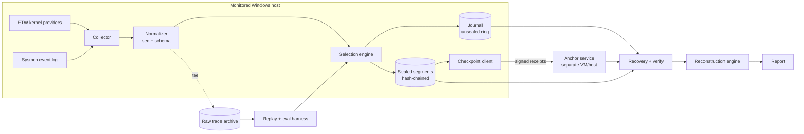

# DESIGN — V-MBOX

## 1. Architecture

Pipeline order matters: **sequence numbers are assigned in the normalizer before selection**, so every later gap can be classified as "dropped by policy" or "lost".

## 2. Components

| Component | Responsibility | Key interface |
|---|---|---|
| Collector | Pull events from sources, tag source, detect and emit `CAPTURE_GAP` | `Source.events() -> Iterator[RawEvent]` |
| Normalizer | Map raw to schema, assign `seq`, `boot_id`, `session_id` | `normalize(raw) -> Event` |
| Selection engine | Decide per event / per window what is retained | `Strategy.observe(event)`, `Strategy.promote(window) -> list[Event]` |
| Journal | Low-latency write-ahead ring of recent events | `append(event)`, CRC frames |
| Segment store | Seal chained segments, enforce budget, evict to tombstones | `seal(records)`, `evict()` |
| Integrity | Chain hashes, checkpoint, verify | `chain.extend()`, `verify(session)` |
| Anchor | Receive checkpoints, sign receipts, chain receipts | TCP/TLS or named pipe |
| Recovery | Enumerate sessions, validate frames/segments, find gaps | `recover(path) -> RecoveryResult` |
| Reconstruction | Timeline + relations with provenance and confidence | `reconstruct(result) -> Timeline` |
| Report | Render JSON + HTML/Markdown | `render(timeline)` |
| Eval harness | Replay raw traces through strategies, compute metrics | `run(trace, strategy, budget, seed)` |

## 3. Collection

### 3.1 Sources and the memory-telemetry limit

| Category | Primary | Fallback / notes |
|---|---|---|
| Process | Sysmon 1 / 5 observed in M1 | ETW `Microsoft-Windows-Kernel-Process` observed, but the unfiltered Python spike overflowed its queue |
| Network | Sysmon 3 observed in M1 | ETW `Microsoft-Windows-Kernel-Network` observed with the same unfiltered-ETW loss limit |
| Memory-related proxies | Sysmon 7 (image load) and 10 (process access) observed in M1 | Sysmon 8 remains enabled but unobserved; `MEM_PROTECT_CHANGE` is excluded until a usable source and real event are validated |

Direct visibility of `VirtualProtect`/RWX transitions generally requires privileged or protected consumers (e.g. the Threat-Intelligence ETW provider) or API hooking. This project does not assume them. If M1 shows no usable source, the memory category is the Sysmon proxy set and every report says "memory-related proxies" explicitly.

M1 VM runs counted 4,408 events at 110.056 events/sec with zero collector queue overflow and 1.873% one-core CPU for Sysmon-only benign noise ([results.json](M1_RESULTS.json), [run record](M1_FINDINGS_SYSMON_ONLY.md)). The unfiltered ETW-only run counted 40,386 events with 20,377 collector queue overflows and 94.637% one-core CPU ([results.json](M1_RESULTS.json), [run record](M1_FINDINGS_ETW_ONLY.md)). Thus the **current unfiltered Python ETW spike is no-go** as a lossless collector at this observed load; Sysmon-only is a provisional Python path, not a completeness claim because Sysmon upstream loss was not measured. The VM lists `Microsoft-Windows-Threat-Intelligence` and a `PROTECTVM` task in provider metadata, but subscription access and an actual protection-change event were not measured. Provider metadata alone does not validate `MEM_PROTECT_CHANGE`. No direct memory-protection visibility is claimed.

All sources implement one `Source` interface, including a `ReplaySource` that reads a recorded raw trace. This is what makes the evaluation deterministic.

### 3.2 Collector failure handling

- Sources run in their own threads with a bounded queue to the normalizer.
- Queue overflow increments a drop counter and emits `CAPTURE_GAP` with `approx_missed`.
- ETW buffer-loss notifications are surfaced as `CAPTURE_GAP`.
- Collector start/stop produce `COLLECTOR_START` / `COLLECTOR_STOP`; a missing STOP in a session is itself evidence of abnormal termination.

## 4. Selection engine

All strategies receive the same stream, the same total budget `B`, and the same journal size `J`, and are judged on identical raw traces.

**Baselines for the evaluation (not strategies under test):** unbounded full log (upper bound), and FIFO ring of size `B`.

### 4.1 Fixed-policy
Static allow-list of event types (e.g. PROC_START, NET_CONNECT, MEM_REMOTE_THREAD) kept; everything else dropped. When full, evict oldest sealed segments (FIFO).

### 4.2 Priority-based
Static weight per event type plus simple modifiers (unsigned image, uncommon parent/child, external destination). At seal time keep highest-priority records until the segment byte target is met. Eviction removes the lowest mean-priority sealed segment, not simply the oldest.

### 4.3 Context-aware (the research component)
Same base priorities as 4.2, plus **windowed context promotion**:

1. Every event passes through the journal (recent history is durable, though unverified).
2. A per-PID and per-lineage context tracker maintains recent activity (spawn tree, recent memory-related events, recent connections).
3. **Trigger rules** (initial set, versioned and frozen before evaluation):
   - memory-related event, then outbound `NET_CONNECT` from the same PID within window `W`
   - `MEM_REMOTE_THREAD` / suspicious `MEM_PROCESS_ACCESS`, then activity from the target PID
   - process spawned by a process that recently had a flagged event (lineage inheritance)
4. On trigger, promote the surrounding window: events from the involved PIDs and their lineage within `[t - pre, t + post]` are marked high priority and kept when journal records are sealed.
5. Promoted context is protected from eviction longer than ordinary records.

Triggers mean "preserve more here", not "this is an attack".

**Design tension, stated openly:** holding events to decide what to keep means undecided events sit in volatile memory. The journal exists to bound that loss: nothing waits only in RAM beyond the journal flush interval. The cost is journal size counted against the same total budget.

**Anti-overfitting rule:** trigger rules are written from general behavior patterns before looking at evaluation results, then frozen. Any later change is a new, labeled experiment version.

### 4.4 Budget accounting
Total budget `B` covers journal + sealed segments + tombstones. Strategies compared at equal `B`.

## 5. Storage

- Journal: ring file, CRC-framed (`SCHEMA.md` §3). Flush policy configurable (every N events or T ms); persistence latency measured per policy.
- Sealing: when the selector releases a batch, write segment to `*.tmp`, `fsync`/`FlushFileBuffers`, rename to final, then update the chain and send the checkpoint. A segment without a valid footer is treated as incomplete, never complete.
- Eviction: delete body, write tombstone (retains `segment_hash`), chain stays verifiable.
- Incomplete writes: detected by CRC (journal) and missing/invalid footer or hash mismatch (segment); reported as `incomplete_write` gaps.

## 6. Integrity and trust

- Chain: `H(i) = SHA-256(H(i-1) || S(i))`, genesis from the session manifest.
- Anchor: separate process on a second VM (or host), owns an Ed25519 key. It signs receipts over checkpoints and chains them. The host holds only the anchor public key and a transport credential.
- What this achieves: an attacker who gains host control *after* a checkpoint cannot rewrite earlier anchored segments without a mismatch against signed receipts. Truncation or deletion of recent unanchored segments is detectable as missing receipts.
- What it does not achieve: it cannot prove events were true. A compromised collector can fabricate or suppress events and they will be stored and chained faithfully. Timestamps from the host are not trusted; anchor time is recorded alongside.
- If the anchor is unreachable, the recorder continues, records the outage, and later segments are marked `chained` rather than `anchored`.

Integrity levels in reports: `anchored` > `chained` > `journal_only` > `unverified`; `tampered` when checks fail.

## 7. Recovery and reconstruction

Recovery order: enumerate sessions → validate journal frames (CRC) → validate segments and chain → verify receipts against the anchor pubkey → classify gaps → hand surviving records to reconstruction.

Reconstruction builds:
- **Timeline** ordered by `seq` within a boot/session, not by timestamp alone.
- **Derived relations** with explicit basis: parent/child by PID+PPID+image (guarding against PID reuse using start-time), process↔connection by PID.
- **Inferred relations** (temporal proximity, sequence patterns) always labeled `inferred`, confidence never `high`.

Reports list gaps and what the gaps could hide. No sentence in a report states intent, attribution, or exfiltration.

## 8. Metrics

Let `G` = ground-truth attack-relevant events (from frozen labels), `C` = subset of `G` the collector observed, `P` = subset of `C` persisted and recoverable.

| Metric | Definition |
|---|---|
| Collection coverage | `|C| / |G|` — separates collector limits from selection quality |
| Evidence coverage | `|P| / |C|` (and `|P| / |G|` reported alongside) |
| Reconstruction accuracy | Event ordering agreement (e.g. Kendall tau vs true order) and relation precision/recall vs labeled relations |
| Storage efficiency | `|P| / bytes_retained`, i.e. relevant events per MB |
| Event-loss rate | Generated events not persisted *and* not accounted for by selection stats |
| Persistence latency | Observation timestamp to durable write (p50, p95) |
| Crash-recovery rate | Committed records recoverable after N forced terminations |
| Overhead | CPU %, working set, disk bytes/s, with collector on vs off under the same workload |

Statistics: multiple seeds per scenario, report mean with 95% CI, and the number of runs. Do not claim differences smaller than the variance.

## 9. Threat model

| Threat | Handled? | How |
|---|---|---|
| Crash / power loss | Partly | Journal + sealed segments; data between flushes can be lost, quantified |
| Dropped telemetry | Detected | `CAPTURE_GAP`, seq gaps |
| Storage saturation | Handled | Budgeted eviction with tombstones |
| Torn writes | Detected | CRC, footer, atomic rename |
| Modification of stored records | Detected | Chain + anchored receipts |
| Full chain rewrite by host-level attacker | Detected only for anchored range | Anchor signatures |
| Compromised collector (fabrication/suppression) | **Not prevented** | Documented limit; tested in M9 to show behavior |
| Manipulated timestamps | **Not prevented** | seq ordering + anchor time give partial cross-check |
| Compromised anchor | Out of scope | |
| Evidence never captured | Unrecoverable | Reported as collection coverage |

## 10. Report design

Two outputs from the same JSON: machine-readable `report.json`, and a single-file `report.html` for investigators.

HTML layout, top to bottom:
1. Header: host, boot, session, strategy, budget, collector version
2. **Evidence status panel:** integrity result, anchored vs chained vs unverified counts, gaps, tombstones
3. **Timeline:** filterable by PID/type, each row badged with integrity level
4. **Process/connection view:** tree of derived relations with basis shown on hover
5. **Inferred patterns** (visually distinct, labeled "inferred")
6. **Limitations** (always present, never collapsed)

Style: plain, high-contrast, no alarm colors for inferences. Red is reserved for integrity failures.

## 11. Design decisions log

| ID | Decision | Alternative | Why |
|---|---|---|---|
| D1 | Journal + sealed segments | Seal-only | Bounds volatile loss for context-aware buffering |
| D2 | Custom segment format | SQLite | Clean hash chain, torn-write handling, tombstones |
| D3 | `seq` assigned pre-selection | Post-selection | Makes policy drops distinguishable from loss |
| D4 | Offline replay for evaluation | Live-only comparison | Same inputs for every strategy; reproducible |
| D5 | Anchor on separate VM with own key | Same-host service | Approximates the independent recorder without hardware |
| D6 | Sysmon 7/10 are the measured memory-related proxies; Sysmon 8 remains unobserved; omit `MEM_PROTECT_CHANGE` | Use the registered Threat-Intelligence `PROTECTVM` task | M1 VM metadata shows the task exists, but access and a real event were not measured; provider registration is insufficient evidence |
| D11 | Do not use the current unfiltered Python ETW spike as the collector at measured load | Keep the unfiltered ETW subscription | ETW-only M1 run overflowed its queue 20,377 times at 94.637% one-core CPU; a narrower ETW subscription or another hot path needs separate validation |
| D7 | Canonical JSON Lines raw trace with a separate exact-byte SHA-256 sidecar | Hash embedded in trace | Keeps the trace stream replayable and makes incomplete writes explicit |
| D8 | UUIDv5 from session ID and sequence | Random event IDs | Labels remain stable across strategy replays |
| D9 | Two checksummed journal cursor slots and explicit wrap padding | Scan an unmarked ring | Identifies the live frame window and flags torn or stale bytes after wrap |
| D10 | Tombstone metadata has an unkeyed canonical checksum | No tombstone checksum | Detects accidental byte corruption while leaving host-rewrite limits explicit |
